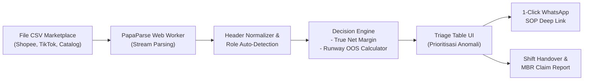

# SIRCLO Insight — Omnichannel Anomaly Detection Engine

[](https://react.dev/)
[](https://www.typescriptlang.org/)
[](https://vitejs.dev/)
[](https://tailwindcss.com/)
[](https://vitest.dev/)
[](https://vercel.com/)
[](https://github.com/)

SIRCLO Insight adalah sistem pendukung keputusan operasional e-commerce multi-channel (*pure client-side*) yang dirancang khusus untuk Account Manager (AM) brand omnichannel (Shopee, TikTok Shop, dll.).

Aplikasi ini mendeteksi kebocoran margin (*margin bleed* di bawah harga modal COGS/HPP), pembengkakan anggaran promo (*budget breach*), serta risiko kehabisan stok (*out of stock / OOS*) dalam hitungan detik secara otomatis langsung dari file ekspor marketplace tanpa ketergantungan server backend.

---

## Masalah Bisnis yang Dipecahkan

| Masalah Operasional | Dampak Finansial & Reputasi | Solusi SIRCLO Insight |
| :--- | :--- | :--- |
| **Margin Bleeding** | Transaksi produk terjual di bawah COGS akibat penumpukan voucher dan potongan admin platform (8.5%). | Audit otomatis setiap baris pesanan terhadap COGS riil dan estimasi potongan admin marketplace. |
| **Promo Budget Breach** | Anggaran bakar uang marketing (*intentional burn*) jebol tanpa disadari di tengah periode kampanye. | Pemantauan akumulasi kerugian secara *real-time* terhadap batas pagu anggaran (*budget cap*). |
| **Risiko OOS & Penalti Toko** | Lonjakan penjualan mendadak saat flash sale yang berujung pembatalan massal (*Non-Fulfillment Rate*). | Deteksi sisa jam ketahanan stok (*runway hours*) dinamis, rekomendasi suntik stok gudang, atau rem laju order. |
| **Inefisiensi Analisa Manual** | Tim AM menghabiskan 30-45 menit mengolah spreadsheet Excel per jam di masa krisis. | Waktu triase dipangkas menjadi < 5 detik dengan visualisasi baris anomali terfilter agresif. |

---

## Arsitektur Teknologi

| Komponen | Stiker & Teknologi | Deskripsi Implementasi |
| :--- | :--- | :--- |
| **Frontend Framework** |    | Single Page Application berbasis React 18 dengan sistem tipe data ketat TypeScript dan bundler Vite berperforma tinggi. |
| **Styling & UI** |    | Antarmuka bergaya Apple dengan tema Dark/Light mode, ikon SVG profesional bebas emoji, dan pulse animation pada banner darurat. |
| **Parsing Engine** |   | Streaming parsing multi-file CSV di thread latar belakang (Web Worker) tanpa membekukan tampilan utama antarmuka. |
| **Audio Synthesizer** |  | Pembangkit nada lonceng peringatan darurat sintetis (*dual-tone oscillator* 880Hz ke 440Hz) tanpa dependensi file audio eksternal. |
| **Testing Suite** |  | 37 automated test suite mencakup validasi matematika margin, stock runway OOS, parsing CSV, hingga URL encoding WhatsApp. |
| **Deployment** |  | Hosting statis global dengan konfigurasi rewrite SPA `vercel.json` dan pemuatan aset demo yang aman. |

---

## Alur Data Sistem



---

## Fitur Utama

- **Multi-File Omnichannel Drag & Drop:** Menerima 5 file laporan sekaligus tanpa format kaku:
  - Laporan Penjualan Shopee (*Shopee Sales*)
  - Laporan Penjualan TikTok (*TikTok Sales*)
  - Master Katalog Internal (*Master Catalog & COGS*)
  - Laporan Stok Etalase Shopee (*Shopee Inventory*)
  - Laporan Stok Etalase TikTok (*TikTok Inventory*)
- **1-Click Demo Data Loader:** Tombol pemuatan cepat untuk menguji seluruh skenario anomali menggunakan dataset riil di folder statis.
- **Kalkulasi True Net Margin:**
  $$\text{Net Realized Payout} = \text{Deal Price} + \text{Subsidi Platform} - \text{Voucher Toko} - \text{Estimasi Biaya Admin (8.5\%) }$$
  $$\text{True Net Margin} = \text{Net Realized Payout} - \text{COGS}$$
- **Evaluasi Runway Berbasis Moving Window:** Pilihan mode sensitivitas (Normal 3 jam vs Mega Flash Sale 1 jam) untuk mendeteksi ancaman kehabisan stok secara presisi.
- **Mitigasi Darurat Buffer Gudang Kosong:** Menyarankan protokol rem laju pesanan (naikkan harga etalase 15% dan matikan belanja iklan berbayar) saat buffer fisik di gudang kosong.
- **1-Click WhatsApp Escalation:** Membuka universal link `wa.me` dengan draft pesan SOP terformat sesuai PIC tujuan (Pricing/Ads vs Warehouse).
- **Laporan Serah Terima Shift (Shift Handover Report):** Salin rekapitulasi teks terstruktur ke clipboard dalam satu klik untuk koordinasi pergantian shift antar-AM dan bahan klaim MBR.
- **In-App Multi-Sensory Alert:**
  - Banner darurat merah dengan animasi denyut (*pulse*).
  - Flasher dinamis judul tab browser saat pengguna sedang membuka tab lain.
  - Nada lonceng Web Audio sintetis dengan opsi mute/unmute.
- **100% Data Privacy:** Semua komputasi berjalan di memori lokal peramban (RAM browser). Tidak ada data transaksi yang dikirim ke server pihak ketiga.

---

## Struktur Direktori

```text
ai-prototyping/
├── public/
│   └── data/                    # Dataset CSV omnichannel demo
│       ├── internal_master_data.csv
│       ├── shopee_inventory_report.csv
│       ├── shopee_sales_report.csv
│       ├── tiktok_inventory_report.csv
│       └── tiktok_sales_report.csv
├── src/
│   ├── components/              # Komponen antarmuka (TriageTable, Dropzone, EmergencyBanner, dll.)
│   ├── engine/                  # Logika pengambilan keputusan (margin, runway, escalation, shift-report)
│   ├── hooks/                   # Custom hooks (useCriticalSound, useTabTitle, useLocalStorage)
│   ├── ingestion/               # Parser CSV, pembersih nominal Rupiah, deteksi peran file
│   ├── lib/                     # Formatter mata uang, helper notifikasi, utilitas styling
│   ├── types/                   # Definisi tipe TypeScript domain & skema anomali
│   ├── App.tsx                  # Komponen utama dengan navigasi tab dan state manager
│   └── main.tsx                 # Entrypoint Vite React
├── tests/                       # Pengujian otomatis Vitest (6 test suite, 37 skenario)
├── docs/                        # Dokumentasi arsitektur, PRD, dan SOP eskalasi
├── generate_mock_data.py        # Skrip Python pembuat data sintetis demo
├── vercel.json                  # Konfigurasi deployment Vercel SPA
└── package.json                 # Konfigurasi dependensi dan skrip proyek
```

---

## Panduan Menjalankan Proyek Secara Lokal

### Prasyarat
- Node.js versi 18.x atau lebih baru
- npm versi 9.x atau lebih baru

### 1. Instalasi Dependensi
```bash
npm install
```

### 2. Menjalankan Server Pengembangan
```bash
npm run dev
```
Aplikasi dapat diakses melalui browser di alamat `http://localhost:5173`.

### 3. Menjalankan Pengujian Otomatis
```bash
npm test
```

### 4. Melakukan Kompilasi Produksi
```bash
npm run build
```
File hasil kompilasi siap rilis akan disimpan di dalam direktori `dist/`.

### 5. Memeriksa Pratinjau Build Produksi
```bash
npm run preview
```

---

## Panduan Deployment ke Vercel

Proyek ini telah dikonfigurasi secara lengkap dengan `vercel.json`:

1. Commit seluruh perubahan ke repositori Git:
   ```bash
   git add .
   git commit -m "feat: complete project documentation with tech badges"
   git push origin main
   ```
2. Kunjungi [Vercel Dashboard](https://vercel.com) dan pilih **Add New Project**.
3. Import repositori proyek dari GitHub.
4. Vercel akan mendeteksi konfigurasi secara otomatis:
   - **Framework Preset:** `Vite`
   - **Build Command:** `npm run build`
   - **Output Directory:** `dist`
5. Klik **Deploy**. Aplikasi akan aktif dan dapat diakses publik dalam waktu ~30 detik.
