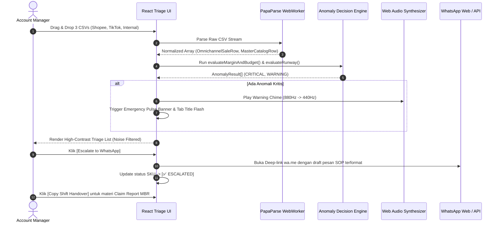

# 05. System Architecture Blueprint

Blueprint ini menggambarkan arsitektur teknis sistem SIRCLO Insight, dimulai dari fase prototipe tanpa backend (Day 0) hingga skala produksi penuh terintegrasi Cloud & Live API (Day 180).

---

## 1. MVP Architecture (Day 0 Proof — 100% Client-Side Engine)
Pada fase MVP, kita menghindari pembuatan infrastruktur *cloud* dan *database* persisten. Tujuannya adalah memvalidasi kelayakan *Decision Engine* secepat mungkin di mesin lokal milik 17 Account Manager tanpa menanti persetujuan *security review* API marketplace yang memakan waktu berbulan-bulan.

### A. Tech Stack MVP:
- **UI Framework:** React + Vite + TypeScript.
- **Styling & Components:** Tailwind CSS + Lucide React + Shadcn UI (High-Contrast Triage Table & Notification Bell Drawer).
- **Parsing Library:** `PapaParse` dengan konfigurasi Web Worker (`worker: true`) agar penguraian puluhan ribu baris data tidak membekukan UI (*thread safe*).
- **Sound Synthesis:** Native Web Audio API (menghasilkan nada alarm peringatan tanpa aset audio eksternal).
- **State & Local Persistence:** 
  - *Data In-Memory (Zero Persistence):* Raw sales CSV dan Master data hanya hidup di memori RAM browser (hilang saat tab ditutup/refresh demi keamanan data sensitif).
  - *Config & Coordination State (`localStorage`):* Menyimpan pengaturan nomor WhatsApp PIC, status *Escalated* per SKU, dan preset sensitivitas agar tidak hilang saat reload.

### B. Flow MVP:


---

## 2. Evolution Architecture (Day 180 - Full Omnichannel Autopilot)
Jika MVP sukses memangkas waktu triase dari 45 menit menjadi < 30 detik dan membuktikan penghematan puluhan juta rupiah, sistem melangkah ke otomatisasi tanpa campur tangan CSV manual.

```mermaid
graph TD
    subgraph External Platforms
        Shopee[Shopee Open API <br/> Webhooks]
        TikTok[TikTok Shop API <br/> Webhooks]
    end

    subgraph Internal Data Sources
        ERP[SIRCLO ERP / COGS Database]
    end

    subgraph Data Pipeline & Analytics (Cloud)
        EventBus[Kafka / PubSub <br/> Stream Processor]
        OLAP[(ClickHouse / BigQuery)]
        Airflow[Airflow ETL (Hourly Sync)]
    end

    subgraph Intelligence Core (Backend)
        Engine[Anomaly Rule Engine <br/> Go / Node.js Microservice]
        Allocator[Auto-Allocator Service]
    end

    subgraph Client & Notification
        Dashboard[Web Triage Dashboard]
        Bot[WhatsApp Escalation Bot]
    end

    Shopee -->|Live Order Events| EventBus
    TikTok -->|Live Order Events| EventBus
    ERP -->|Master Data| Airflow
    Airflow --> OLAP
    EventBus --> OLAP
    
    OLAP -->|Query per 5 mins| Engine
    Engine -->|Trigger Margin Bleed| Dashboard
    Engine -->|Trigger Critical Alert| Bot
    Engine -->|Trigger OOS| Allocator
    
    Allocator -->|POST Stock Rebalance API| Shopee
    Allocator -->|POST Stock Rebalance API| TikTok
```

### Perubahan Kunci di Fase 180 Hari:
1. **No More CSV:** Diganti dengan Live Webhooks (pesanan masuk langsung dihitung kecepatannya secara *real-time*).
2. **OLAP Database:** Perhitungan agregat (*total sold*, *velocity*) dilakukan secara masif di ClickHouse.
3. **Closed-Loop Action:** Alih-alih eskalasi manual ke WhatsApp untuk masalah OOS, `Auto-Allocator Service` akan otomatis mengeksekusi penambahan stok langsung via Shopee/TikTok API (*Zero Human Intervention*). WhatsApp hanya digunakan untuk persetujuan anomali ekstrem (Margin Bleed).
